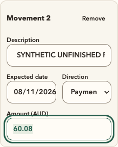
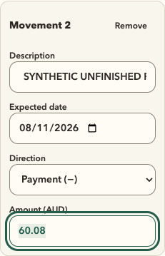
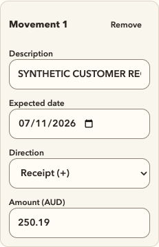

# Read the whole movement direction

At a 320px viewport, the deployed forecast at `8bb2c6d56393c55fc3d88fd527709f0f6f2688fa` clipped both native Direction selections. A receipt and a payment are different financial movements; the selected label needs to remain readable. The adjacent date also had little room for its native affordance.

Movement fields now stack below the existing `sm` breakpoint. Date and Direction each get a full row, while the wider two-column layout stays the same. The implementation changes three class strings. It keeps native controls, 14px type, 44px targets, the existing Soft Precision tokens and keyboard order. Financial calculations, validation, sample replacement, CSV serialization and PDF generation are unchanged.

| Before: clipped payment at 320px | After: full date and payment |
| --- | --- |
|  |  |

The control grows from 96.5px to 205px at 320px. After reserving padding and a conservative 24px for the native select affordance, 155px remains for the longest tested label, measured at 78.11px. The captures establish visible fit; absence of page overflow alone was insufficient to catch this problem. The [design-system contract](../../apps/site/DESIGN-SYSTEM.md) now calls for checking selected labels and full dates explicitly.

The [evidence record](2026-11-07-forecast-direction-evidence.json) covers 320, 390, 639, 640, 768 and 1440px. It checks stacking below 640px, shared rows at and above it, unchanged values, 44px controls and no horizontal page overflow. Both movement crops and the complete forecast capture at 1440px are byte-identical to the live baseline.

Eight local production-browser checks cover entry from the tools directory, two movements, native keyboard selection, date-to-Direction-to-amount focus order, Keep/Escape with valid and invalid drafts, correction and removal, loaded offline behavior, reduced motion, forced colours, emulated touch and a real CSV download. The synthetic forecast ends at $9,940.48. Baseline and local CSV downloads are byte-identical: 1,236 bytes, SHA-256 `771d015983ca118506c046a33b760988048dfdce3034d0c65c2405d9f275635e`. Site tests (100), invoice tests (34), typecheck, lint, the 15 token checks and the direct production build passed locally.

The browser harness initially assumed ArrowDown would commit the native select and one Tab would leave a date control. Chromium on macOS required native type-ahead followed by Tab and navigation through the date's internal segments. The corrected journey uses those actual keyboard interactions; the app has no special workaround.

An independent Astra Max review inspected the scoped source, actual captures and downloaded CSV files. Its verdict was **ship**, with no scoped P0/P1 findings or requested revision. It independently confirmed the three class-string changes and the byte-identical desktop and CSV evidence. Test execution remains the main session's work; artifact inspection is not another browser or test run.

This is local pre-release evidence. The exact candidate, CI, publication and live verification have separate records. Coverage is Chromium with viewport and touch emulation; physical hardware, screen readers, other engines and OS-native popup behavior remain unqualified. The main-page error listener does not cover the separate touch context. Hallmark, Appllama and image generation were not executed for this bounded layout fix. CI access, runner and DNS gates remain unchanged.
