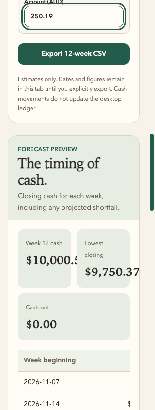
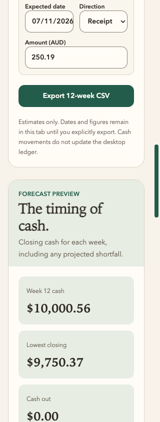
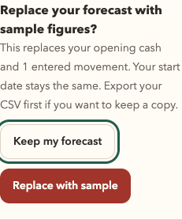

# Keep the forecast before exploring a sample

This bounded pass starts from deployed source `ab522aa0558f9710eee0668bcb814e2ed81814f5`. A real Chromium journey entered $9,750.37 opening cash and a $250.19 customer receipt. **Use sample figures** immediately replaced both with $12,000.00 and four examples, without confirmation. All data used in this review is synthetic.

The planner now asks before replacing an edited opening balance or any entered movement. A small native fieldset appears beside the sample action. It explains the effect, names the movement count and focuses **Keep my forecast** first. Keep or Escape on either decision closes it and returns focus; editing the forecast dismisses the pending confirmation. Only **Replace with sample** changes the figures. The chosen start date remains, and an untouched planner still loads its sample in one click.

The confirmation uses the existing type, colour, focus and Button contracts. It adds no modal, illustration, animation, persistence or financial capability. Raw input stays in the current form until replacement is explicit. Calculations, tax rules, CSV serialization, PDFs and the native ledger are unchanged.

## Reflection and correction

The desktop and narrow review found a second, pre-existing problem in this same flow: at 320px, the two-column cash summary clipped the ordinary $10,000.56 result. Baseline and candidate viewport captures reproduced it. The summary now stacks below `sm`, keeping the existing three-column wider layout. At 320px the longest tested value uses 128.34px of 199px available; all three values also fit at 390, 768 and 1440px. This does not claim extreme-value layout coverage.

| Before: clipped baseline total | After: readable stacked totals |
| --- | --- |
|  |  |

The [evidence record](2026-11-07-forecast-replacement-evidence.json) includes the live baseline, 14 local production-browser checks, four-width summary measurements, screenshots and hashes. The current forecast remains exportable during confirmation: the before/kept CSV files are byte-identical, 1,194 bytes, SHA-256 `520e6973a0daed342686816fb8bd79c9c10885138a7748e890da415ccf062130`. Explicitly accepted sample CSV is 1,382 bytes, SHA-256 `2935d3084c00cc9051a0e8e525b8b1879462d60919e16c87a231152e48d4de43`, ending at $16,100.00.

Five regression tests cover an edited opening balance with no rows, Keep/Escape retention and focus, explicit replacement with the chosen date preserved, invalidating confirmation after a movement edit, and the missing-date boundary. The site suite passed 100 tests; typecheck and lint passed. Root lint retains 136 existing warnings and 54 informational diagnostics, with no errors. The exact release candidate has separate build, test and publication records.

The browser checks exercised keyboard, local export, offline loaded behavior, reduced motion, forced colours and emulated touch. Both confirmation actions remain 44px high at 320, 390, 768 and 1440px. Measured token contrast is 5.82:1 for secondary copy, 13.82:1 for Keep and 6.70:1 for Replace. An initial focus assertion expected a keyboard outline after pointer input; it was corrected to use Tab/Shift+Tab. A later full-page capture caught an existing smooth-scroll paint transition; the final viewport evidence waits for scroll stability. Neither required an application workaround.

An independent Astra Max reviewer read the scoped source/tests, inspected the actual captures and independently compared the CSV bytes. Its bounded verdict was **ship**, with no remaining P0/P1 in the replacement guard or narrow-summary correction. It did not run a browser, build or test command; those execution results came from this review's supplied records.

This document records local pre-release evidence, not publication or CI success. No physical-device, screen-reader, other-engine, OS-print or native-desktop qualification is claimed. Hallmark/Appllama were not executed in this pass. Runner setup, CI credentials and DNS migration retain their separate gates.
