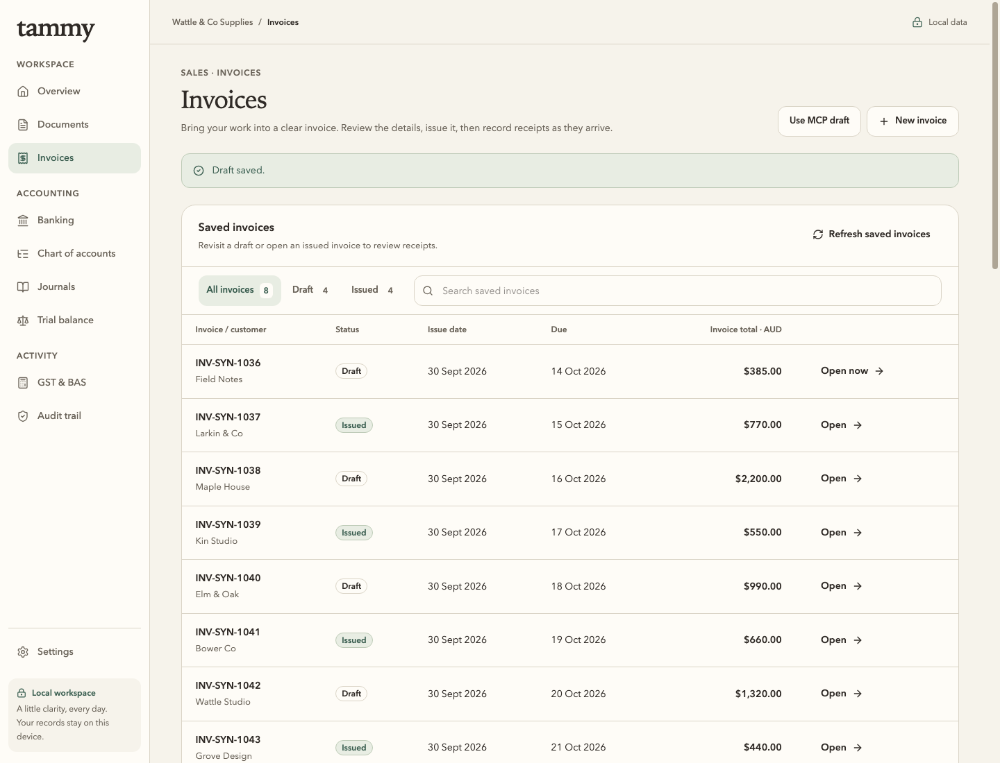
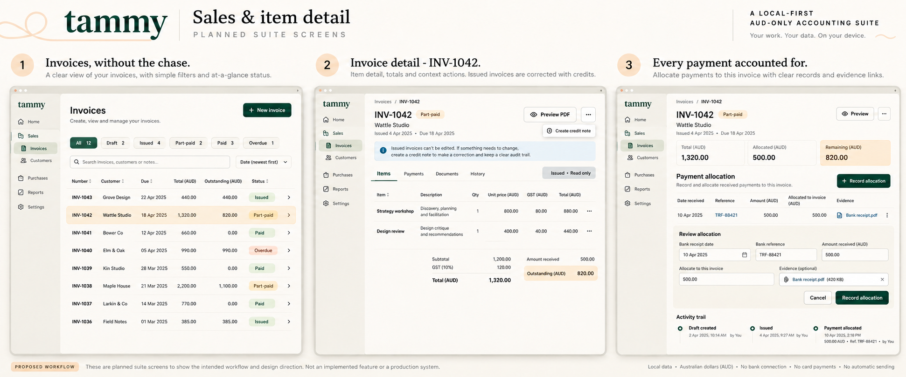
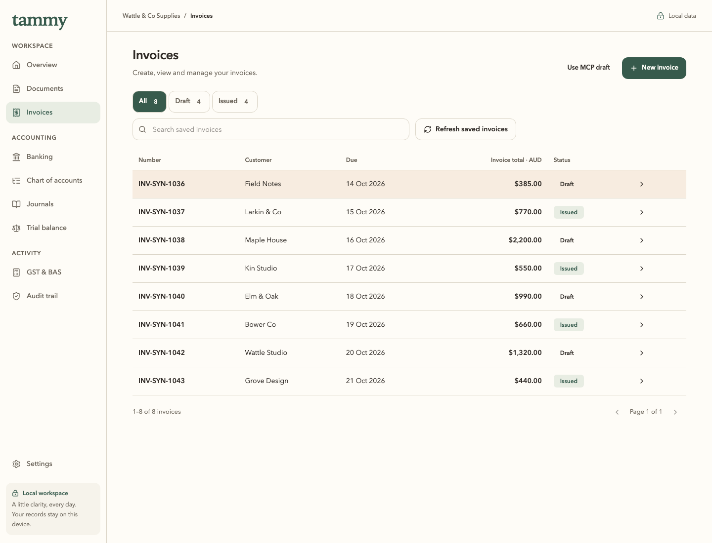

# Invoice list fidelity — board 07

[Before / reference / after comparison](comparison.html). Both real app frames use
**1440 × 1100**, the same eight isolated synthetic invoices and actual supported
writes: four Draft, four Issued. The source board is retained byte-for-byte in
reference/. Its left app window is uniformly normalized in the comparison viewer;
its unknown generated viewport is not presented as a pixel-perfect runtime baseline.

| Before | Approved reference | Corrected after |
| --- | --- | --- |
|  |  |  |

The list is now the arrival view, with edit/detail behind New/Open and an explicit
Back. Compact working typography, a forest wordmark/primary action and selected
filter, single-line columns, flat ivory surfaces and quiet status tints follow the
reference. All eight rows fit; measured row heights are 56.5–57px. No illustration
is added to the table, matching board 07. The written tokens remain authoritative.

Search, filters and page survive return, and row/search focus is restored. Keep
editing retains unsaved changes; explicit discard writes nothing. The [filtered
return](after/02-filtered-return-1440.png), [390px](after/03-invoice-list-390.png)
and [320px](after/03-invoice-list-320.png) captures show actual app states. Narrow
tables have named focusable scrolling regions; the document fits its available
width and reduced motion remains enabled during that check.

The corrected capture journey passes **1/1 in 12.7s** without retries, page or
console errors. The separate complete financial regression passes **1/1 in 12.2s**:
invalid edits/repeated saves, issue cancel/confirm, immutable issued fields, payment
cancel/repeated click, PDF cancel/private export, back/forward and narrow amount
access. Native values remain $1,320 total, $500 received and $820 outstanding.
Focused unit tests pass **75/75 in nine files**; TypeScript and lint pass with the
existing 135 warnings/two infos. Ordinary package verification passes seven
applicable checks, with one Windows-only skip. Package source is clean **08802fca**.

The first rendered attempt failed the narrow keyboard-scroll assertion: a new grid
wrapper expanded the page. Its three screenshots and failure classification remain
in attempt-1-after. It also exposed a selected-filter cascade error. The wrapper and
canonical WorkFilters variant were corrected; no assertion or timeout was relaxed.
Raw runtime diagnostics remain private outside Git. This is an evidence-based
correction, not an unexplained flaky retry.

All **128 prior app screenshots and 55 archived files remain byte-identical**.
[Hashes](screenshots.json), [journeys](journeys.json), [measurements](after/measurements-1440.json),
[package provenance](package.json) and [Library delivery](library-delivery.json) are retained.
The reference is clearly labelled as a concept, never real app evidence.

This block addresses the invoice list, not acceptance of every Soft Precision
screen. Editor/detail composition remains a separate visual review against board
07 panels 2/3 and board 02. Only actual Draft/Issued statuses are used; receipt
balances remain in their verified detail view. No unsupported sending, stock,
credits or payment gateway is added. The local SBR startup diagnostic is paused
with original evidence intact; no release, signing, credential or PR-state action
occurs. The strict static audit still reports the same 19 inherited findings (14 native
forms, four test mocks and the CSV textarea), with no exclusions. It is not green.
A later qualification-only update retains forest selection and saved-table
keyboard scrolling in the regular CI journey; application source is unchanged
since the clean capture package. Hosted checks must be assessed at the new head.
